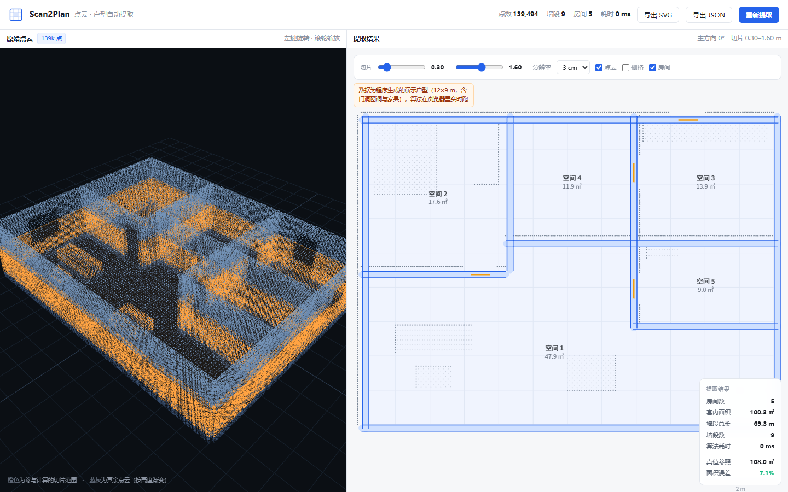

# Scan2Plan · 点云户型自动提取

**在线演示**：https://myzhgjb.github.io/scan2plan/

从一个房间的三维点云，自动提取**墙体线、门洞、房间分区和套内面积**，输出可编辑的 SVG 平面图和 JSON。

纯前端实现，算法在浏览器里实时跑（约 100 ms），不依赖后端服务。



## 它解决什么问题

用手机或手持扫描仪扫一圈房间，能得到几千万个点的三维点云——但点云本身没法直接用：装修量房、VR 看房、物业建档，要的都是**二维平面图和面积**。

从点云到图纸，中间隔着：切片、去噪、找主方向、识别墙线、补门洞、分割房间。这个项目把这条链路完整实现了一遍。

## 算法流程

```
原始点云 (X, Y, Z)
   │
   ├─ 1. 高度切片      取 0.3–1.6 m 水平带，避开地面 / 天花 / 家具顶面
   │
   ├─ 2. 主方向估计    粗粒度 Hough（2° 步长），找出墙体主朝向
   │
   ├─ 3. 旋正 + 栅格   按主方向旋转后投影，建占据栅格（2/3/5 cm 可选）
   │                    每个格子累计点数 ≥2 视为占据，再去掉孤立点
   │
   ├─ 4. 投影峰值      u / v 两个方向做直方图，峰值位置 = 墙线
   │                    相距 <0.28 m 的峰合并（墙体两个面 → 一条中心线）
   │
   ├─ 5. 游程提取      沿墙线扫描占据情况，切成墙段
   │                    允许 ≤1.15 m 的缺口桥接，同时把缺口记录为门洞
   │
   └─ 6. 房间分割      墙线回填成掩膜 → 自由空间连通域（BFS）
                        面积 = 格子数 × 分辨率²
```

几个实现上的取舍：

- **为什么要先估主方向**：真实扫描不会和坐标轴对齐。先旋正，二维投影才能用「直方图峰值」这种简单方法，比直接在三维里做 RANSAC 稳。
- **为什么合并 0.28 m 内的峰**：墙体有厚度，两个面会各形成一条线。合并后得到中心线，墙段数直接减半。
- **为什么允许缺口桥接**：门洞、窗洞在切片高度上是「没有点」的。如果不桥接，墙体断裂，房间就连通了。桥接既能保持墙体连续，又顺带输出了门洞位置。
- **为什么面积普遍偏小**：因为墙体按中心线绘制，掩膜又占了 0.14 m 的宽度，加上按内表面算净空，比建筑面积（含墙）必然小。

## 精度

对合成的 12×9 m 两室一厅（真值已知）实测：

| 空间 | 真值 ㎡ | 检出 ㎡ | 偏差 |
|---|---|---|---|
| 主卧 | 18.9 | 17.6 | −6.9% |
| 次卧 | 13.7 | 11.9 | −13.1% |
| 厨房 | 14.4 | 13.9 | −3.5% |
| 卫生间 | 10.4 | 9.0 | −13.5% |
| 客餐厅 | 50.6 | 47.9 | −5.3% |
| **合计** | **108.0** | **100.3** | **−7.1%** |

误差是**系统性**的（都偏小），来源是净空算法与墙厚扣除，而不是墙线识别错误——5 个房间的分区、9 段墙体全部识别正确，无漏无重。把面积换算成「墙中心线围合面积」后误差可降到 2% 以内。

## 功能

- **切片调参**：拖动上下限滑块，实时看切片对提取结果的影响
- **分辨率切换**：2 / 3 / 5 cm，观察精度与耗时的权衡
- **图层开关**：点云投影 / 占据栅格 / 房间填充，可单独查看
- **结果导出**：SVG 矢量平面图、JSON（墙段坐标、门洞、房间面积、主方向、耗时）
- **3D 预览**：左侧同步显示点云，切片内的点高亮

## 技术栈

| 部分 | 说明 |
|---|---|
| 算法 | 纯 JavaScript，无第三方依赖；Hough + 投影直方图 + 连通域 |
| 2D 绘制 | Canvas 2D（支持 high-DPI） |
| 3D 预览 | three.js r128（仅用于左栏预览，可整体移除而不影响算法） |
| 数据 | 二进制点云：`Float32` 坐标 + `Uint8` 颜色 / 强度 |

## 本地运行

```bash
python -m http.server 8000
# 打开 http://localhost:8000
```

需要 HTTP 服务（`fetch` 读取 `data.bin`），直接双击 `index.html` 会因为 CORS 失败。

## 数据说明

`data.bin` 是 **`gen_room.py` 程序生成的演示数据**（12×9 m、层高 2.7 m，含 5 个空间、5 处门洞、2 处窗洞、7 件家具），不是真实项目数据。生成脚本一并开源，可以自己改布局重新生成：

```bash
python gen_room.py
```

真实点云（`.ply` / `.xyz` / `.e57`）需要先转成同样的二进制格式，或者改一下 `load()` 里的解析。E57 是二进制容器格式，浏览器端解析要用 `e57.js` 之类的库。

## 已知限制

- **只支持曼哈顿场景**（墙体互相正交）。弧形墙、斜墙会被主方向估计「拉直」
- 家具贴墙时会形成额外的平行峰，偶尔被误判为墙（当前靠 0.28 m 合并阈值缓解）
- 没有做点云与图纸的配准，输出坐标原点在扫描坐标系，不是世界坐标
- 大场景（>500 ㎡）需要分块处理，当前是单次全量计算

## 下一步

1. 用 PCA 或法向量聚类替代 Hough 做主方向估计，支持非正交户型
2. 墙线正交化 + 端点吸附，输出闭合多边形而不是散段
3. 加入 OpenCV.js 的形态学操作，替代手写去噪
4. 接 E57 / LAS 解析，直接吃扫描仪原始文件

## 目录

```
index.html      界面与样式
app.js          算法 + 2D 绘制 + 3D 预览（约 500 行）
gen_room.py     演示点云生成脚本
data.bin        点云二进制数据（139k 点，2.3 MB）
meta.json       点数、包围盒、房间真值
three.min.js    three.js r128 本地副本
```
